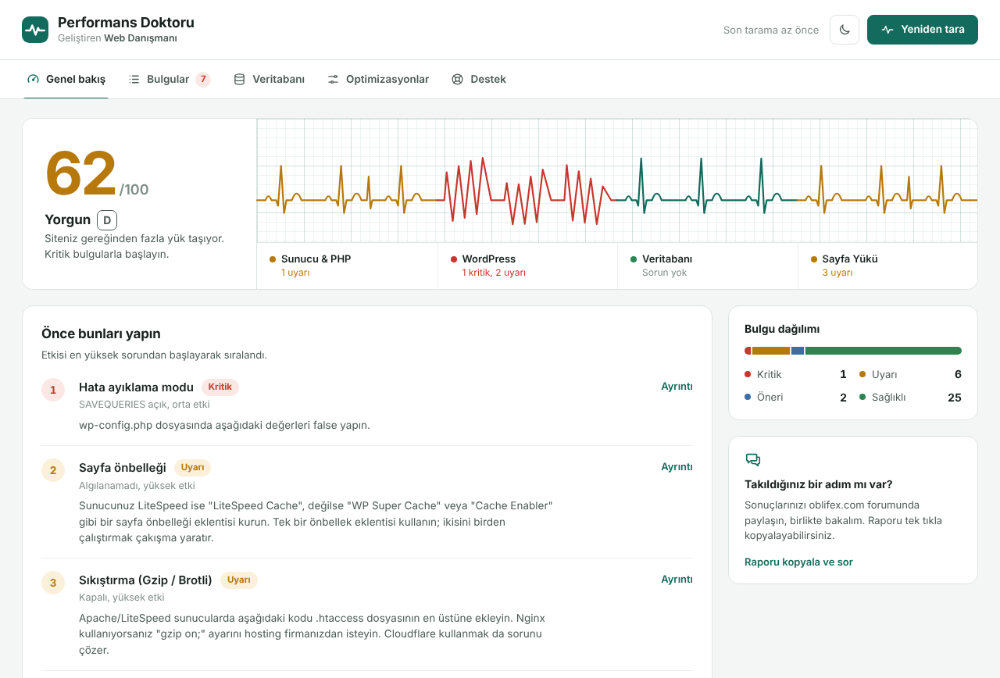
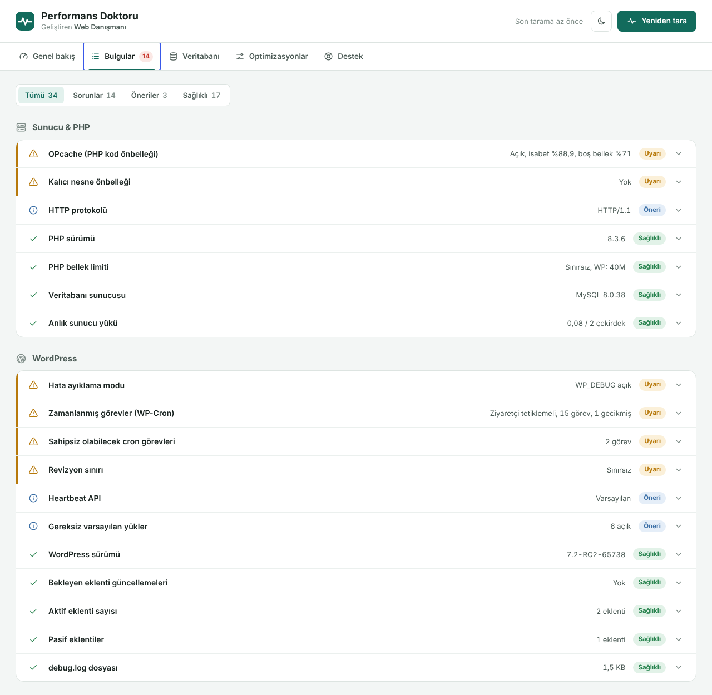
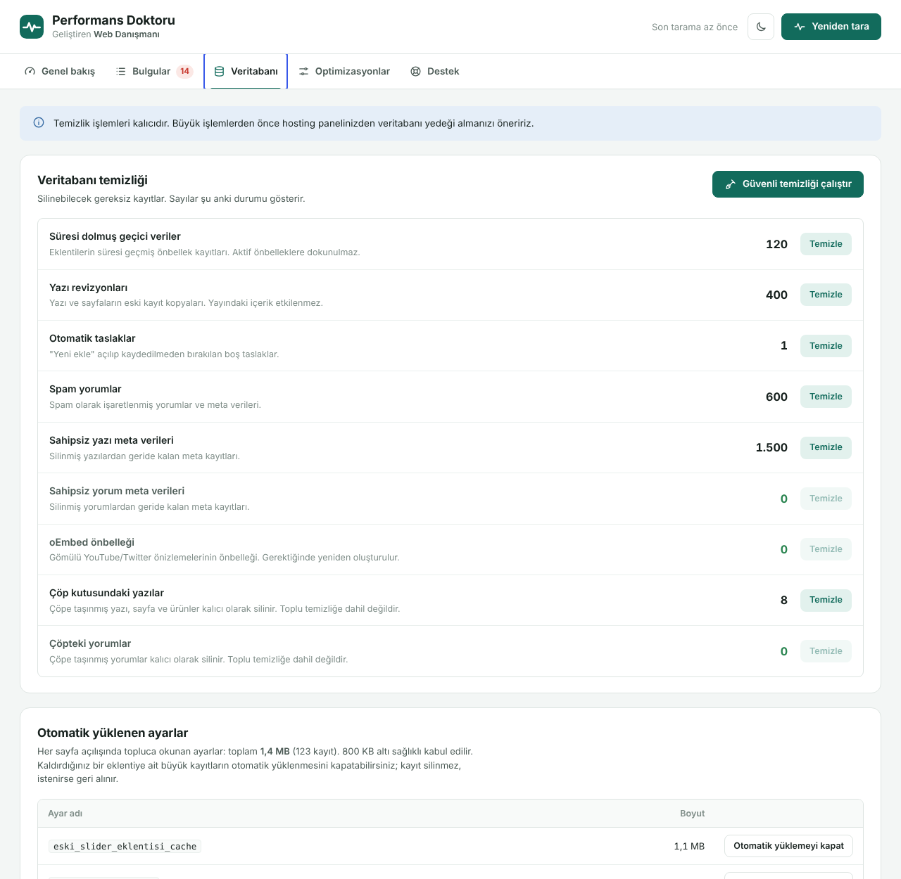
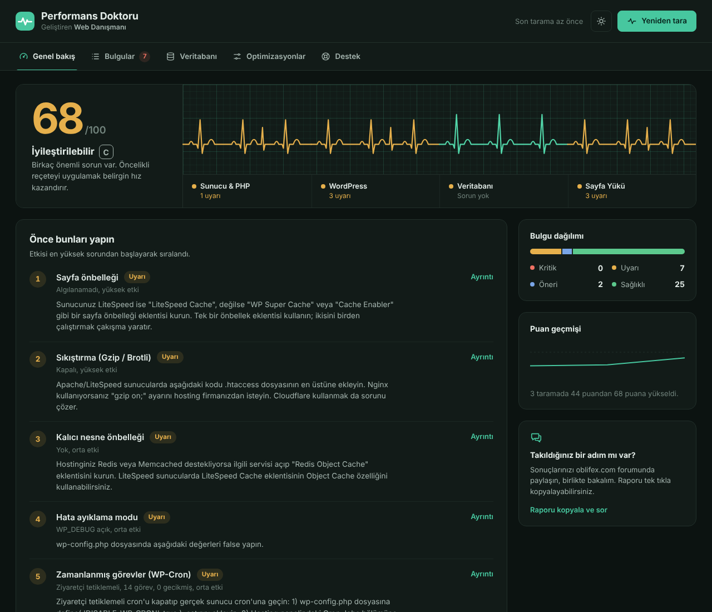
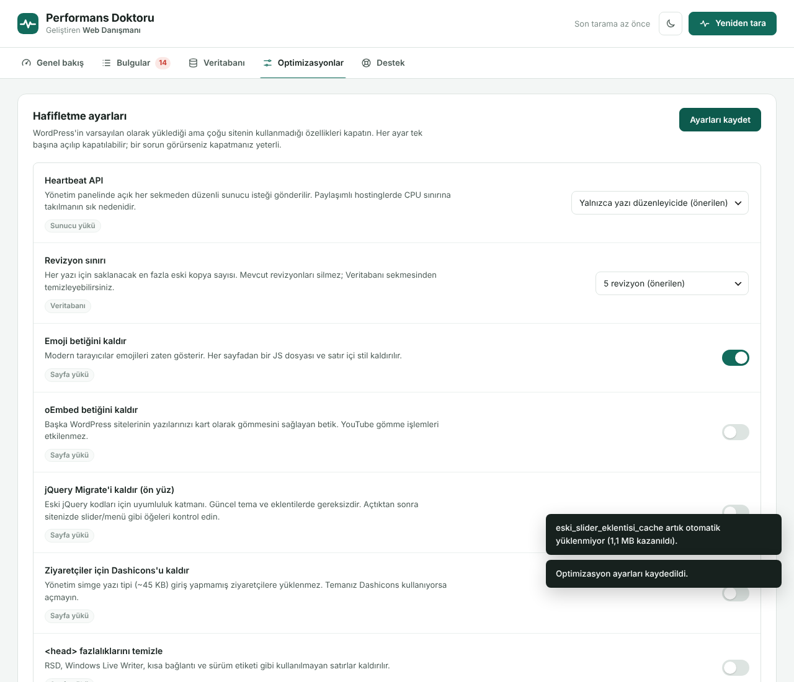
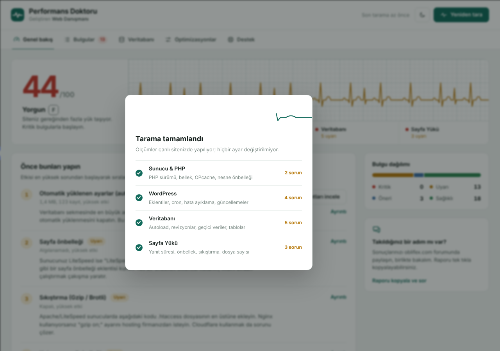
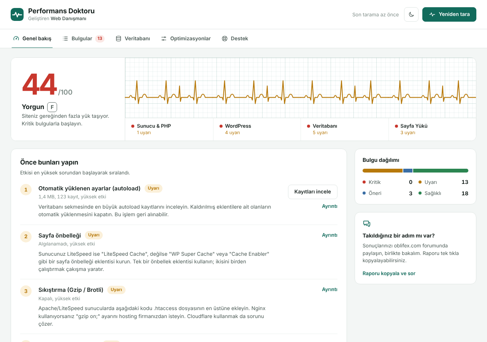
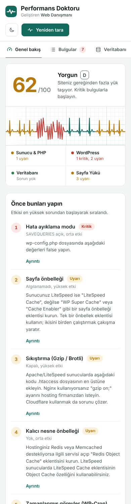

# WD Performans Doktoru

**WordPress sitenizi en çok yoran sorunları bulur ve nasıl çözeceğinizi söyler.** 
**Finds what slows your WordPress site down and tells you how to fix it.**

[**Türkçe**](#türkçe) · [**English**](#english)

Geliştirici / Developer: **[Web Danışmanı](https://webdanismani.com)** 
Destek / Support: **[oblifex.com](https://oblifex.com)** webmaster destek forumu / webmaster support forum

---

## Türkçe

### Nedir?

WD Performans Doktoru, sitenizin neden yavaş olduğunu tahmin etmek yerine **ölçer**. Sunucu ayarlarını, veritabanını, eklentilerin ana sayfanıza yüklediği dosyaları ve önbellek durumunu kontrol eder. Bulduğu her sorunu etkisine göre sıralar ve ne yapmanız gerektiğini sade bir Türkçeyle anlatır. Kolay olanları tek tıkla düzeltir.

Tarama sitenizde **hiçbir şeyi değiştirmez**. Çözümler yalnızca siz onayladığınızda uygulanır.

Sonuçlar bir hasta monitörü gibi gösterilir: her kategori sitenin "kalp atışında" bir bölümdür. Sağlıklı bölümler düzenli atar, sorunlu bölümler sarı ya da kırmızı ve düzensiz çizilir.

### Neleri kontrol eder?

| Kategori | Kontroller |
|---|---|
| **Sunucu ve PHP** | PHP sürümü, bellek limiti, OPcache (isabet oranı ve bellek doluluğu dahil), Redis/Memcached nesne önbelleği, MySQL/MariaDB sürümü, HTTP/2, anlık sunucu yükü |
| **WordPress** | Çekirdek ve eklenti güncellemeleri, eklenti sayısı, WP_DEBUG ve SAVEQUERIES, büyüyen debug.log, WP-Cron yapılandırması, kaldırılmış eklentilerden kalan sahipsiz cron görevleri, Heartbeat, revizyon sınırı |
| **Veritabanı** | Autoload boyutu ve en büyük kayıtlar, süresi dolmuş geçici veriler, revizyonlar, taslaklar, spam yorumlar, sahipsiz meta kayıtları, tablo şişkinliği, MyISAM tablolar |
| **Sayfa yükü** | Ana sayfaya gerçek istek gönderilerek ölçülür: yanıt süresi, sayfa önbelleği (LiteSpeed, Cloudflare, Varnish, WP Rocket vb.), Gzip/Brotli, tarayıcı önbelleği, **hangi eklentinin kaç JS/CSS dosyası yüklediği**, sayfayı engelleyen betikler, üçüncü taraf alan adları, görsel yükleme düzeni |
| **WooCommerce** | Action Scheduler kuyruğunda biriken ve gecikmiş görevler, süresi dolmuş müşteri oturumları, HPOS durumu, sepet parçaları (cart fragments) |

### Tek tıkla çözümler

- **Veritabanı temizliği:** Büyük tablolarda zaman aşımına düşmemek için işlemi parça parça yapar. "Güvenli temizlik" düğmesi çöp kutusuna dokunmaz.
- **Autoload yönetimi:** Kaldırılmış eklentilerden kalan büyük ayarların otomatik yüklenmesini kapatır. Her değişiklik geri alınabilir. WordPress çekirdeğinin ayarları korunur.
- **Tablo optimizasyonu** ve **MyISAM → InnoDB** dönüşümü
- **Sahipsiz cron görevlerini** kaldırma
- **Hafifletme ayarları:** Emoji, oEmbed, jQuery Migrate, XML-RPC, Dashicons, Heartbeat, revizyon sınırı, WooCommerce sepet parçaları
- Kod gerektiren çözümler (wp-config.php, .htaccess, crontab) için **kopyalanmaya hazır kod**

### Ekran görüntüleri

| Bulgular | Veritabanı |
|---|---|
|  |  |

| Koyu tema | Optimizasyonlar |
|---|---|
|  |  |

| Tarama | İlk açılış | Mobil |
|---|---|---|
|  |  |  |

### Kurulum

1. [Releases](../../releases) sayfasından son sürümün `wd-performans-doktoru.zip` dosyasını indirin.
2. WordPress panelinde **Eklentiler › Yeni Ekle › Eklenti Yükle** ekranından ZIP dosyasını yükleyip etkinleştirin.
3. Sol menüdeki **Performans** bağlantısına tıklayın ve **Siteyi tara** düğmesine basın. Tarama yaklaşık 20 saniye sürer.

> GitHub'daki yeşil **Code › Download ZIP** düğmesiyle indirilen dosya da çalışır, ancak klasör adı `wd-performans-doktoru-main` olur. Releases sayfasındaki ZIP'i kullanmanızı öneririz.

### Gereksinimler

- WordPress 5.8 veya üstü (7.1 ile test edildi)
- PHP 7.4 veya üstü
- `manage_options` yetkisine sahip yönetici hesabı

### Sık sorulan sorular

**Tarama sitemi değiştirir mi?** 
Hayır. Tarama yalnızca okuma yapar. Temizlik ve optimizasyonlar yalnızca siz düğmeye bastığınızda çalışır.

**Önbellek eklentisinin yerini tutar mı?** 
Hayır. Sorunları teşhis eder ve kolay olanları düzeltir. Sayfa önbelleği için sunucunuza uygun bir önbellek eklentisi önerir.

**"Ana sayfa ölçümü yapılamadı" uyarısı alıyorum.** 
Sunucunuz kendi sitesine istek gönderemiyor demektir. Bakım modu, site şifresi veya sunucu IP adresini engelleyen bir güvenlik duvarı olabilir. Bu durum WP-Cron'u da etkiler.

**Eklentiyi silersem ne olur?** 
Tüm ayarları ve tarama geçmişi silinir. Kapattığınız autoload kayıtları otomatik olarak eski haline getirilir.

### Destek

Sorularınız, hata bildirimleriniz ve önerileriniz için **[oblifex.com](https://oblifex.com) webmaster destek forumunu** kullanın. Eklentideki **Destek** sekmesinden forumda paylaşabileceğiniz raporu tek tıkla kopyalayabilirsiniz. Rapor şifre, e-posta veya kişisel veri içermez.

Profesyonel hız optimizasyonu hizmeti için: **[webdanismani.com](https://webdanismani.com)**

### Lisans

Bu eklenti **ücretsiz paylaşılır ve satılamaz.** [CC BY-NC-SA 4.0](LICENSE) lisansıyla yayınlanmıştır.

- ✅ Ücretsiz indirebilir, kullanabilir ve paylaşabilirsiniz.
- ✅ Kendi sitelerinizde ve müşteri sitelerinizde kullanabilirsiniz.
- ✅ Değiştirebilirsiniz. Değiştirilmiş sürümü paylaşırsanız aynı lisansla ve Web Danışmanı'nı kaynak göstererek paylaşmanız gerekir.
- ❌ Eklentiyi veya değiştirilmiş bir sürümünü **satamazsınız**.
- ❌ Ücretli bir pakete, temaya veya üyelik içeriğine ekleyerek **dağıtamazsınız**.

---

## English

### What is it?

WD Performans Doktoru (*Performance Doctor*) **measures** why your site is slow instead of guessing. It checks server settings, the database, the files each plugin loads on your homepage, and your caching setup. Every issue is ranked by impact and comes with a plain-language fix. The easy ones can be fixed with one click.

Scanning **changes nothing** on your site. Fixes are applied only when you confirm them.

Results are shown like a patient monitor: each category is a segment of the site's "heartbeat". Healthy segments beat steadily; problem areas are drawn in amber or red with an irregular rhythm.

> The plugin interface is currently in Turkish. English translation is planned.

### What does it check?

| Category | Checks |
|---|---|
| **Server & PHP** | PHP version, memory limit, OPcache (hit rate and memory usage), Redis/Memcached object cache, MySQL/MariaDB version, HTTP/2, current server load |
| **WordPress** | Core and plugin updates, plugin count, WP_DEBUG and SAVEQUERIES, growing debug.log, WP-Cron setup, orphaned cron events left behind by removed plugins, Heartbeat, revision limit |
| **Database** | Autoloaded options size and largest entries, expired transients, revisions, drafts, spam comments, orphaned meta, table overhead, MyISAM tables |
| **Page load** | Measured with a real request to your homepage: response time, page cache (LiteSpeed, Cloudflare, Varnish, WP Rocket and more), Gzip/Brotli, browser caching, **how many JS/CSS files each plugin loads**, render-blocking scripts, third-party domains, image loading |
| **WooCommerce** | Past-due and piled-up Action Scheduler tasks, expired customer sessions, HPOS status, cart fragments |

### One-click fixes

- **Database cleanup** runs in batches so large tables don't time out. "Safe cleanup" never touches the trash.
- **Autoload management** turns off autoloading for large options left behind by removed plugins. Every change can be undone; WordPress core options are protected.
- **Table optimization** and **MyISAM → InnoDB** conversion
- Removal of **orphaned cron events**
- **Lightweight settings:** emoji, oEmbed, jQuery Migrate, XML-RPC, Dashicons, Heartbeat, revision limit, WooCommerce cart fragments
- **Ready-to-copy code** for fixes that need wp-config.php, .htaccess or crontab changes

### Installation

1. Download `wd-performans-doktoru.zip` from the latest [release](../../releases).
2. In WordPress, go to **Plugins › Add New › Upload Plugin**, upload the ZIP and activate it.
3. Click **Performans** in the admin menu and press **Siteyi tara** (*Scan site*). A scan takes about 20 seconds.

### Requirements

- WordPress 5.8 or later (tested with 7.1)
- PHP 7.4 or later
- An administrator account (`manage_options` capability)

### FAQ

**Does scanning change my site?** 
No. Scanning is read-only. Cleanups and optimizations run only when you click them.

**Does it replace a caching plugin?** 
No. It diagnoses problems and fixes the easy ones. For page caching it recommends a caching plugin that suits your server.

**What happens if I delete the plugin?** 
All of its settings and scan history are removed, and any autoload changes you made are automatically reverted.

### Support

For questions, bug reports and suggestions, use the **[oblifex.com](https://oblifex.com) webmaster support forum**. The plugin's **Destek** (*Support*) tab copies a ready-to-post report with one click. The report contains no passwords, emails or personal data.

Professional speed optimization services: **[webdanismani.com](https://webdanismani.com)**

### License

This plugin is **free and not for sale.** It is released under [CC BY-NC-SA 4.0](LICENSE).

- ✅ You may download, use and share it for free.
- ✅ You may use it on your own sites and your clients' sites.
- ✅ You may modify it. If you share a modified version, it must use the same license and credit Web Danışmanı.
- ❌ You may **not sell** the plugin or a modified version of it.
- ❌ You may **not bundle** it into paid packages, themes or membership content.

---

Geliştirici / Developer: **[Web Danışmanı](https://webdanismani.com)** · Destek / Support: **[oblifex.com](https://oblifex.com)**

© 2026 Web Danışmanı

